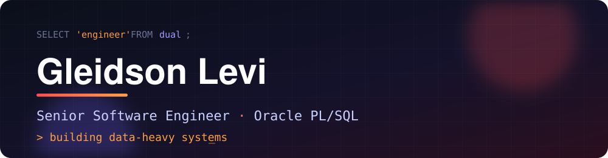

<div align="center">



<br>

[](https://www.linkedin.com/in/gleidsonlevi/)
[](mailto:gleidsonlevism@gmail.com)
[](https://github.com/Levixs)

</div>

<br>

## `> whoami`

```plsql
DECLARE
  v_nome      VARCHAR2(50)  := 'Gleidson Levi';
  v_cargo     VARCHAR2(50)  := 'Senior Software Engineer';
  v_empresa   VARCHAR2(50)  := '@my-hubs';
  v_foco      SYS.ODCIVARCHAR2LIST := SYS.ODCIVARCHAR2LIST(
                'Oracle PL/SQL', 'Modelagem de dados', 'APIs REST', 'Automação com IA');
BEGIN
  DBMS_OUTPUT.PUT_LINE(v_nome || ' | ' || v_cargo || ' @ ' || v_empresa);
  FOR i IN 1 .. v_foco.COUNT LOOP
    DBMS_OUTPUT.PUT_LINE('  -> ' || v_foco(i));
  END LOOP;
END;
/
```

<br>

## `> stack`

<div align="center">


</div>

<details>
<summary><b>Ferramentas do dia a dia</b></summary>
<br>

`Toad for Oracle` · `PL/SQL Developer` · `SQL Developer` · `SQL Navigator` · `DBeaver` · `Embarcadero` · `DBDiagram` · `Visual Studio` · `VS Code` · `Bitbucket` · `cPanel` · `Trello` · `Monday`

</details>

<br>

## `> projetos`

<div align="center">

<a href="https://github.com/Levixs/open-maestri"></a>

</div>

<br>

## `> stats`

<div align="center">


</div>

<br>

<div align="center">

<sub>`COMMIT;` e bola pra frente.</sub>

</div>
